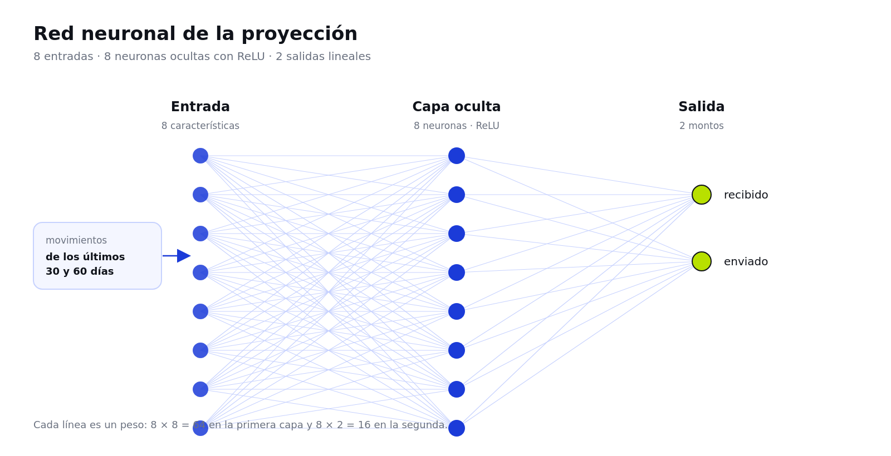

# Entrega final — prototipo transaccional basado en blockchain

Documento de consolidación para la entrega en Canvas y guion de la sustentación.
Reúne el acceso al prototipo, la evidencia de las pruebas, la ficha del servicio de
Inteligencia Artificial, el guion de la demostración en vivo, el inventario de
evidencias y los huecos que quedan antes de entregar.

**Nota de alcance.** La documentación del repositorio se alineó el 19 de noviembre de
2026 sobre el árbol de trabajo del commit
`a1327b13a01be1756657da6d7468f09c3343c697` (`a1327b1`). Ese commit ya contenía este
documento, la evidencia fresca de pruebas y las capturas 11 y 23 del ayudante; sobre ese
árbol se actualizaron el README, la arquitectura y el alcance, el recorrido de los casos
de uso, las evidencias, el cronograma y el informe de pentest, y se agregó el registro de
la socialización. El remoto todavía no tiene esos cambios: la rama local está por delante
de `origin/main` (véase la sección 6).

| Campo | Valor |
| --- | --- |
| Proyecto | Joss077UMB-ProyectoBlockChain |
| Documento académico de referencia | `documentacion_proyecto_transaccionales.pdf` (Grupo 1, Universidad Manuela Beltrán) |
| Commit de referencia | `a1327b13a01be1756657da6d7468f09c3343c697` (`a1327b1`, 19 de noviembre de 2026); las novedades de la ronda documental están en el árbol de trabajo |
| Fecha de este documento | 19 de noviembre de 2026 |
| Repositorio | https://github.com/J0ss077/Joss077UMB-ProyectoBlockChain |
| Alcance | Nodo único de un ledger transaccional; prototipo local sin despliegue público |
| Estado global | Prototipo y pruebas: cumple. Servicio de IA: parcial. Documentación: alineada. Pendientes: decisión del enlace público, subida de los commits y grabación/acta de la socialización (véase la sección 6) |

**Veredicto de conjunto.** El prototipo transaccional está implementado, corriendo y
probado: la suite completa cierra en `525 passed, 1 skipped` y el lint no reporta
hallazgos. El servicio de Inteligencia Artificial tiene un componente completo y
evidenciado —la proyección con red neuronal— y un componente funcional, con evidencia de
su guía local, pero sin captura de una respuesta de un modelo de lenguaje —el ayudante
conversacional—. La documentación del repositorio quedó alineada con el estado real del
prototipo, y la evidencia fresca de pruebas y las capturas del ayudante están versionadas
en el commit `a1327b1`. La entrega no tiene despliegue público: el acceso es local y
reproducible con los comandos del README. La socialización y la demostración en vivo se
documentan en [evidencias/socializacion/README.md](evidencias/socializacion/README.md);
la grabación y el acta todavía no se anexan. Quedan tres pendientes antes de entregar:
decidir el enlace o despliegue, subir los commits y anexar la grabación y el acta.

---

## 1. Acceso al prototipo final

### 1.1 Qué se entrega como acceso

No hay una URL pública ni un despliegue. El repositorio no incluye un `Dockerfile` de
la aplicación, un `Procfile`, un túnel ni una máquina publicada, y el documento de
arquitectura lo declara: «no hay despliegue» (`docs/arquitectura-y-decisiones.md`, en
«Qué es el sistema y qué no»). El servidor que se documenta es local:
`http://127.0.0.1:5000`.

Por lo tanto, el «enlace o acceso al prototipo final» se entrega como **acceso local
reproducible**: el repositorio, el README con los comandos exactos y los datos de
demostración que siembra `python -m src.bootstrap`. Cualquier persona con el
repositorio y Docker o Podman puede levantar el prototipo completo siguiendo los pasos
de la sección 1.2.

Existe además un antecedente de ejecución verificada el 19 de noviembre de 2026: la
aplicación respondía en `http://127.0.0.1:5000` (proceso `python -m src.web`) y
PostgreSQL 16.15 estaba publicado en `127.0.0.1:55432` como contenedor
`postgres:16-alpine` en estado saludable. Esa instancia es la que se usó para tomar la
evidencia visual más reciente.

### 1.2 Puesta en marcha reproducible

Los comandos se escriben para Linux o macOS; en Windows el intérprete es
`.venv\Scripts\python`. El README tiene la versión completa con las variantes de
Windows y Podman.

```text
python -m venv .venv
.venv/bin/python -m pip install -r requirements.txt
cp .env.example .env
```

En `.env` hay que reemplazar los valores de plantilla: `MASTER_KEY` se genera propia y
se escribe en el archivo, y `SESSION_SECRET` y `ADMIN_PASSWORD` deben tener valores
propios. El lector rechaza los valores de ejemplo, de modo que sin este paso la
aplicación no arranca.

```text
.venv/bin/python -c "from cryptography.fernet import Fernet; print(Fernet.generate_key().decode())"
docker compose up -d
.venv/bin/python -m src.bootstrap
.venv/bin/python -m src.web
```

Se abre `http://127.0.0.1:5000`. Pasos opcionales para que las pantallas de
estadísticas, la agenda y la proyección tengan datos con historia:

```text
.venv/bin/python -m src.historial_demo
.venv/bin/python -m src.demo_social
```

La proyección con red neuronal exige TensorFlow, que no está en el
`requirements.txt` del proyecto sino en `red_neuronal/requirements.txt`. Para verla en
la página de estadísticas se levanta la aplicación con el entorno que lo tiene:

```text
python3.14 -m venv .venv-tf
.venv-tf/bin/python -m pip install -r red_neuronal/requirements.txt
.venv-tf/bin/python -m src.web
```

Sin TensorFlow el resto del prototipo funciona igual: la tarjeta de proyección
simplemente no aparece (`docs/red-neuronal.md`, «Nota de implementación»).

### 1.3 Cuentas de demostración

Las cuentas las siembra `python -m src.bootstrap`. La contraseña de las cinco cuentas
comunes es `demostracion`; la del administrador es la que se escriba en
`ADMIN_PASSWORD` dentro de `.env` y no está versionada.

| Usuario | Rol | Wallet que maneja | Contraseña |
| --- | --- | --- | --- |
| `admin` | administrador | ninguna | la de `ADMIN_PASSWORD` en `.env` |
| `constituyente` | usuario | la del constituyente | `demostracion` |
| `fondo` | usuario | la del fondo | `demostracion` |
| `asociado1` | usuario | un asociado | `demostracion` |
| `asociado2` | usuario | otro asociado | `demostracion` |
| `asociado3` | usuario | el tercer asociado | `demostracion` |

La cuenta `constituyente` maneja la wallet de la puerta de entrada del capital y su
saldo disponible es negativo; es la única wallet de la demostración a la que el diseño
le permite el negativo. Las otras cuatro cuentas tienen saldo positivo. El detalle de
los datos sembrados —5 wallets, 4 bloques, 10 transacciones y 6 cuentas— está en el
README, sección «Los datos de demostración».

### 1.4 Estado del repositorio y advertencia

La rama local `main` está **9 commits por delante** de `origin/main`: el remoto apunta a
`899d252` y la copia local a `a1327b1`. Además, al cierre de este documento quedan sin
versionar los cambios de la ronda de alineación documental del 19 de noviembre de 2026
—el README, la arquitectura y el alcance, el recorrido de los casos de uso, las
evidencias, el cronograma, el informe de pentest, el ajuste en
`docs/superpowers/specs/2026-10-10-blockchain-transaccional-design.md` y este
documento—, junto con el nuevo registro de la socialización. Con el commit de esa ronda
la rama quedará 10 commits por delante. Eso significa que el enlace al repositorio
público, tal como está hoy, no contiene el estado documentado ni la evidencia fresca: hay
que subir los commits y los archivos nuevos (véase la sección 6, acción P0-2).

> **PENDIENTE (a): enlace o despliegue público.** El repositorio no tiene despliegue y
> la entrega no incluye una URL pública. Se entrega acceso local reproducible. Si la
> rúbrica exige una URL, hay que publicar una instancia o declarar formalmente que el
> enlace es el repositorio de GitHub más estas instrucciones. No se debe afirmar que
> existe un despliegue.

---

## 2. Criterios de aceptación y evidencias de las pruebas

### 2.1 Resultados literales de la última corrida

La evidencia completa está en
[pruebas-finales-2026-11-19.txt](evidencias/pruebas-finales-2026-11-19.txt). Se ejecutó
sobre el árbol limpio del commit `7291dba`, con un PostgreSQL 16 desechable en
`127.0.0.1:55440` (contenedor `auditoria-pruebas-pg`, imagen `postgres:16-alpine`,
eliminado al terminar). No se usó la base de desarrollo de `127.0.0.1:55432` ni el
servidor de `127.0.0.1:5000`.

| Comando | Resultado literal | Código de salida |
| --- | --- | --- |
| `.venv/bin/ruff check .` | `All checks passed!` | 0 |
| `DATABASE_URL=… TEST_DATABASE_URL=… .venv/bin/pytest tests -q` | `525 passed, 1 skipped in 171.57s (0:02:51)` | 0 |
| `env -u DATABASE_URL .venv/bin/pytest tests/unit -q` | `158 passed, 1 skipped in 1.96s` | 0 |
| Repetición unitaria con el contenedor de PostgreSQL ya eliminado | `158 passed, 1 skipped in 1.84s` | 0 |
| `.venv/bin/pytest tests -q --collect-only` | `525 tests collected in 0.84s` | 0 |

Entorno de la corrida: Python 3.14.9 (piso declarado `>=3.11`), pytest 9.1.1, ruff
0.17.0 y PostgreSQL 16.15 en contenedor. Son 68 archivos de prueba: 47 de integración,
20 unitarios y 1 en la raíz. La única omisión es
`tests/unit/test_dataset.py:13`, que se salta porque `pandas` no está instalado en
`.venv`; es una omisión ambiental declarada, no un fallo ni una prueba inestable.
Además, la suite completa se corrió dentro de `python:3.11-slim` (Python 3.11.18), con
un PostgreSQL 16 desechable y el repositorio montado en solo lectura: `525 passed,
1 skipped` en 156,07 s y código de salida 0. La sección «Corrida en el piso de Python
3.11» de
[pruebas-finales-2026-11-19.txt](evidencias/pruebas-finales-2026-11-19.txt) deja el
comando, el entorno y la salida completa.

La evidencia de Kiwi TCMS es consistente con esta corrida:
`docs/pentesting/evidencias/kiwi/junit.xml` registra `tests=526, failures=0, errors=0,
skipped=1`. El JUnit corresponde al commit `899d252`, el mismo código que el estado
entregado; la corrida fresca es del `7291dba` y mide ese mismo código.

### 2.2 Casos de uso y sus pruebas

| Caso de uso | Ruta | Prueba que lo demuestra | Resultado |
| --- | --- | --- | --- |
| CU-01 Registrar una wallet | `POST /wallets` | `tests/unit/test_req_01_wallet.py`; `tests/integration/test_req_01_wallet_en_base.py`; `tests/integration/test_req_24_rutas.py`; `tests/integration/test_req_46_registro_con_dueno.py` | Pasa |
| CU-02 Crear una transacción | `POST /transacciones` | `tests/unit/test_req_02_firma.py`; `tests/unit/test_req_02_transaction.py`; `tests/unit/test_req_04_formato.py`; `tests/unit/test_req_05_saldo.py`; `tests/integration/test_req_24_rutas.py`; `tests/integration/test_req_34_envio.py` | Pasa |
| CU-03 Agrupar en un bloque | `POST /bloques` | `tests/integration/test_req_09_agrupacion.py`; `tests/integration/test_req_08_encadenamiento.py`; `tests/integration/test_req_12_coherencia.py`; `tests/integration/test_req_18_atomicidad.py`; `tests/integration/test_req_14_genesis.py` | Pasa |
| CU-04 Verificar la integridad | `GET /verificar` | `tests/unit/test_req_10_verificacion.py`; `tests/integration/test_req_10_alteracion.py`; `tests/integration/test_req_22_solo_lee.py`; `tests/integration/test_req_39_verificacion.py`; `tests/integration/test_verificar_auditoria.py`; `tests/integration/test_reparacion.py` | Pasa |
| CU-05 Consultar el historial | `GET /historial/<wallet>` | `tests/integration/test_req_13_historial.py`; `tests/integration/test_req_28_historial_desde_la_lista.py`; `tests/integration/test_req_35_alcance.py` | Pasa |

El recorrido funcional de cada caso —ruta, método del dominio, tabla, consulta SQL y
decisión— está en [recorrido-de-casos-de-uso.md](recorrido-de-casos-de-uso.md). La
prueba de coherencia `tests/test_explicacion.py` exige que los cinco casos de uso
aparezcan en ese documento y que cada requerimiento del eje tenga un archivo
`test_req_NN_`; la trazabilidad no se interpreta a mano.

### 2.3 Requerimientos del ledger (REQ-01 a REQ-29)

| REQ | Qué exige la prueba | Archivo de prueba | Resultado |
| --- | --- | --- | --- |
| REQ-01 | Wallet con par de llaves ECDSA; la pública queda en claro y única, la privada nunca en claro | `tests/unit/test_req_01_wallet.py`; `tests/integration/test_req_01_wallet_en_base.py` | Pasa |
| REQ-02 | Una transacción firmada por su emisor verifica; firmada por otra wallet se rechaza | `tests/unit/test_req_02_firma.py`; `tests/unit/test_req_02_transaction.py` | Pasa |
| REQ-03 | La firma repetida se rechaza | `tests/integration/test_req_03_firma_repetida.py` | Pasa |
| REQ-04 | Las cuatro condiciones de formato se comprueban antes de entrar al pool | `tests/unit/test_req_04_formato.py` | Pasa |
| REQ-05 | El saldo disponible descuenta lo comprometido en el pool | `tests/unit/test_req_05_saldo.py` | Pasa |
| REQ-06 | Dos transacciones que juntas exceden el saldo no pasan las dos | `tests/unit/test_req_05_saldo.py` | Pasa |
| REQ-07 | El hash cubre el contenido agrupado; cambiar un dato agrupado lo cambia | `tests/unit/test_req_07_hash.py` | Pasa |
| REQ-08 | Cada bloque se encadena con el hash del anterior | `tests/integration/test_req_08_encadenamiento.py` | Pasa |
| REQ-09 | Las transacciones pendientes se agrupan en un bloque nuevo | `tests/integration/test_req_09_agrupacion.py` | Pasa |
| REQ-10 | Verificar la integridad y localizar el bloque alterado | `tests/unit/test_req_10_verificacion.py`; `tests/integration/test_req_10_alteracion.py` | Pasa |
| REQ-11 | La transacción inválida se rechaza y queda `rejected`, sin bloque | `tests/integration/test_req_11_rechazo_en_base.py` | Pasa |
| REQ-12 | Confirmar las transacciones de un bloque sin romper la coherencia | `tests/integration/test_req_12_coherencia.py` | Pasa |
| REQ-13 | Consultar el historial y el estado del ledger | `tests/integration/test_req_13_historial.py` | Pasa |
| REQ-14 | El bloque génesis se registra con índice 0 y hash previo de sesenta y cuatro ceros | `tests/integration/test_req_14_genesis.py` | Pasa |
| REQ-15 | El esquema vive en `db/init.sql`; el código no ejecuta DDL | `tests/integration/test_req_15_esquema.py` | Pasa |
| REQ-16 | Cargar el dominio no importa el driver de la base | `tests/unit/test_req_16_dominio_aislado.py` | Pasa |
| REQ-17 | Las pruebas de reglas corren sin base de datos y sin definir `DATABASE_URL` | `tests/test_explicacion.py` y la suite `tests/unit` | Pasa |
| REQ-18 | La agrupación en bloque es atómica | `tests/integration/test_req_18_atomicidad.py` | Pasa |
| REQ-19 | Los errores del esquema suben sin traducir ni duplicar los `CHECK` | `tests/integration/test_req_19_errores_del_motor.py` | Pasa |
| REQ-20 | El piso de Python está declarado y el intérprete lo cumple | `tests/test_explicacion.py`; `pyproject.toml` | Pasa |
| REQ-21 | Ningún secreto se versiona; la cadena de conexión se lee del entorno | `tests/unit/test_req_21_cadena_de_conexion.py`; `tests/integration/test_req_21_secretos.py` | Pasa |
| REQ-22 | La verificación de la cadena solo lee | `tests/integration/test_req_22_solo_lee.py` | Pasa |
| REQ-23 | Toda dependencia de `requirements.txt` está fijada con versión exacta | `tests/test_explicacion.py`; `requirements.txt` | Pasa |
| REQ-24 | `POST /wallets` registra una wallet y devuelve la pública | `tests/integration/test_req_24_rutas.py` | Pasa |
| REQ-25 | `POST /transacciones` firma, admite o rechaza y devuelve el estado o el motivo | `tests/integration/test_req_24_rutas.py`; `tests/integration/test_req_11_rechazo_en_base.py` | Pasa |
| REQ-26 | `POST /bloques` agrupa el pool y muestra el eslabón creado | `tests/integration/test_req_24_rutas.py`; `tests/integration/test_req_09_agrupacion.py` | Pasa |
| REQ-27 | `GET /verificar` devuelve el dictamen y, si falla, el bloque alterado | `tests/integration/test_req_24_rutas.py`; `tests/integration/test_verificar_auditoria.py` | Pasa |
| REQ-28 | `GET /historial/<wallet>` lista las transacciones con su estado; un UUID inválido da 404 | `tests/integration/test_req_24_rutas.py`; `tests/integration/test_req_28_historial_desde_la_lista.py` | Pasa |
| REQ-29 | La presentación no decide reglas de negocio ni ejecuta consultas | `tests/unit/test_req_29_presentacion.py` | Pasa |

### 2.4 Requerimientos de usuarios, perfil e IA (REQ-30 a REQ-47)

| REQ | Qué exige la prueba | Archivo de prueba | Resultado |
| --- | --- | --- | --- |
| REQ-30 | Registro con usuario y contraseña; la cuenta queda pendiente y no ingresa | `tests/integration/test_req_30_registro.py`; `tests/integration/test_req_30_semilla.py`; `tests/integration/test_req_30_usuarios.py`; `tests/unit/test_req_36_credenciales.py` | Pasa |
| REQ-31 | El administrador ve los pendientes y aprueba o rechaza; el rechazo es final | `tests/integration/test_req_31_cola.py` | Pasa |
| REQ-32 | Solo ingresa la cuenta aprobada; pendiente y rechazado reciben su estado | `tests/integration/test_req_32_ingreso.py`; `tests/integration/test_req_37_sesion.py` | Pasa |
| REQ-33 | Al aprobar se crea la wallet y se acreditan 1000 en un bloque propio, en una sola operación | `tests/integration/test_req_33_aprobacion.py`; `tests/integration/test_req_33_emision.py`; `tests/unit/test_req_33_emision.py` | Pasa |
| REQ-34 | El emisor del envío sale de la sesión y nunca del formulario | `tests/integration/test_req_34_envio.py` | Pasa |
| REQ-35 | El usuario común solo ve su saldo, su historial y su verificación | `tests/integration/test_req_35_alcance.py` | Pasa |
| REQ-36 | Contraseñas con `scrypt`, sal por usuario y comparación en tiempo constante | `tests/unit/test_req_36_credenciales.py` | Pasa |
| REQ-37 | La sesión se configura desde el entorno y la salida la cierra | `tests/unit/test_req_37_sesion.py`; `tests/integration/test_req_37_sesion.py` | Pasa |
| REQ-38 | Cada ruta declara el rol que exige; el usuario común recibe 403 | `tests/integration/test_req_38_autorizacion.py` | Pasa |
| REQ-39 | La verificación del historial propio se muestra sin exponer el de otras wallets | `tests/integration/test_req_39_verificacion.py` | Pasa |
| REQ-40 | Perfil de la cuenta: datos, foto e idioma, solo sobre la cuenta de la sesión | `tests/integration/test_perfil.py`; `tests/integration/test_foto.py` | Pasa |
| REQ-41 | El cambio de contraseña queda pendiente hasta que el administrador lo aprueba | `tests/integration/test_perfil.py` | Pasa |
| REQ-42 | Contactos por nombre, sin agregarse a sí mismo ni repetir; no se opera sobre ajenos | `tests/integration/test_contactos.py` | Pasa |
| REQ-43 | La interfaz se ve en español o en inglés con una cookie que dura un año | `tests/integration/test_idioma.py` | Pasa |
| REQ-44 | El ayudante con guía local responde sin red y no expone datos de otras cuentas | `tests/integration/test_asistente.py`; `tests/unit/test_asistente_ia.py` | Pasa |
| REQ-45 | El ayudante con IA envía solo el contexto de la cuenta de la sesión y avisa antes | `tests/integration/test_asistente.py`; `tests/unit/test_asistente_ia.py` | Pasa |
| REQ-46 | Al registrar una wallet el administrador elige al dueño; una cuenta no aprobada se rechaza | `tests/integration/test_req_46_registro_con_dueno.py` | Pasa |
| REQ-47 | Una cuenta aprobada puede tener varias wallets y elegir con cuál opera | `tests/integration/test_req_47_varias_wallets.py` | Pasa |

### 2.5 Pruebas de las funciones agregadas después de la Fase 4

Estas funciones no son casos de uso del eje y no tienen número de requerimiento del
eje, pero están cubiertas y forman parte de la defensa.

| Función | Prueba | Resultado |
| --- | --- | --- |
| Auditoría de la cadena y sello de vigilancia | `tests/unit/test_auditoria.py`; `tests/unit/test_sello.py`; `tests/integration/test_auditoria.py`; `tests/integration/test_sello.py`; `tests/integration/test_verificar_auditoria.py` | Pasa |
| Reparación de la cadena (reencadenar, aislar, rechazar pendientes, reagrupar, fijar sello) | `tests/unit/test_reparacion.py`; `tests/integration/test_reparacion.py`; `tests/integration/test_persistencia_de_reparacion.py` | Pasa |
| Estadísticas y proyección del próximo mes | `tests/integration/test_estadisticas.py`; `tests/unit/test_proyeccion.py` | Pasa |
| Navegación entre pantallas y error de conexión | `tests/integration/test_navegacion.py`; `tests/integration/test_conexion.py` | Pasa |
| Arranque y siembra idempotente | `tests/integration/test_bootstrap.py` | Pasa |
| Sabotaje guiado y sus once casos | `tests/integration/test_sabotaje.py` | Pasa |

### 2.6 Evidencia de seguridad

El pentesting se ejecutó el 19 de noviembre de 2026 sobre el commit `899d252` con OWASP
WSTG v4.2 sobre las fases de PTES. El resumen: 4 hallazgos —3 de severidad media y 1
baja—, ninguna severidad alta ni crítica; ZAP no reportó riesgo alto; la revisión
estática no confirmó los avisos de su analizador; y 38 comprobaciones manuales no
produjeron hallazgo. Los hallazgos quedan abiertos con remediación propuesta y
procedimiento de retest, porque el alcance fue evaluar, no corregir.

| Hallazgo | Descripción | Severidad (CVSS 3.1) |
| --- | --- | --- |
| PT-01 | La cookie de sesión sigue autenticando después del cierre de sesión | Media (6.5) |
| PT-02 | El ingreso no limita los intentos fallidos | Media (5.3) |
| PT-03 | El registro permite enumerar cuentas existentes | Media (5.3) |
| PT-04 | Faltan cabeceras de seguridad y se publica la versión del servidor | Baja (3.1) |

El informe completo está en [informe.md](pentesting/informe.md) y
[informe.pdf](pentesting/informe.pdf); la trazabilidad con las pruebas funcionales, en
[matriz-trazabilidad.md](pentesting/matriz-trazabilidad.md).

### 2.7 Estado de las cifras

Las cifras quedaron alineadas en la ronda documental del 19 de noviembre de 2026. La
cifra vigente es `525 passed, 1 skipped` en la suite completa y `158 passed, 1 skipped`
en la suite unitaria sin base; `docs/proceso-y-alcance.md`, `docs/evidencias-fase4.md` y
el README ya la usan. La salida literal histórica del 4 de noviembre está en
`docs/evidencias/pruebas.txt`, que conserva el `386 passed, 1 skipped` de esa fecha y se
declara desactualizado; las demás menciones —en `docs/proceso-y-alcance.md` y en
`docs/evidencias-fase4.md`— la identifican como anterior y dan la cifra vigente. Para
Canvas debe adjuntarse la evidencia fresca
([pruebas-finales-2026-11-19.txt](evidencias/pruebas-finales-2026-11-19.txt)), no la de
noviembre 4.

---

## 3. Servicio de Inteligencia Artificial

En el prototipo hay **dos componentes de IA distintos** y no deben confundirse: el
ayudante en lenguaje natural y la proyección de estadísticas con red neuronal. El
primero explica en palabras simples; el segundo estima dos montos. La ficha de cinco
puntos se presenta por separado para cada uno.

### 3.1 Componente A — Ayudante en lenguaje natural

**1. Qué problema resuelve.** Una persona sin conocimientos técnicos no sabe qué es el
pool, un bloque o una firma. El ayudante vive en su propia pestaña, explica en palabras
simples lo que muestra la pantalla y el estado de la cuenta, y contesta preguntas
escritas. Es de solo lectura: no escribe, no firma y no mueve dinero. Está documentado
en el README, sección «El ayudante y la IA».

**2. Cómo se integra.** La configuración se lee de `ASISTENTE_API_KEY`,
`ASISTENTE_PROVEEDOR`, `ASISTENTE_MODELO` y `ASISTENTE_URL` desde el entorno o el
`.env` (`src/persistence/factory.py`); `src/web/app.py` crea el conector con
`crear_conector` y registra el blueprint del ayudante. Las rutas son `GET /asistente`,
`GET /asistente/ahora` y `POST /asistente/preguntar`, definidas en
`src/web/asistente.py`. Los proveedores se reconocen por el comienzo de la clave en
`src/web/ia.py`; una clave `sk-` ambigua exige `ASISTENTE_PROVEEDOR` y, si no está, no
se manda nada. Sin sesión el ayudante no existe: las rutas de datos responden 401 y la
página redirige al ingreso.

**3. Qué información procesa.** La pregunta escrita, recortada a 600 caracteres, y
hasta 10 turnos de conversación de 1500 caracteres. El contexto de la cuenta: idioma,
rol, nombre de usuario, página actual, saldo disponible, integridad de la cadena y
últimos movimientos con el nombre de la contraparte. Si hay IA configurada, además se
envía el resumen de la cuenta al proveedor externo; la página lo advierte antes de
preguntar. El administrador recibe conteos, no los nombres de las personas
(`tests/integration/test_asistente.py`).

**4. Qué resultado genera.** `POST /asistente/preguntar` devuelve JSON
`{respuesta, sugerencias, fuente}` con `fuente` igual a `"ia"` cuando contestó el
proveedor y `"guia"` cuando contestó la guía local. `GET /asistente/ahora` devuelve
`{pagina, puntos, novedad, sugerencias, ia}`. La interfaz lo pinta con
`src/web/static/js/asistente.js` dentro de la plantilla del ayudante.

**5. Cómo el sistema usa el resultado y qué pasa si falla.** Se muestra en la pestaña
del ayudante; no se guarda, no decide nada y no altera el ledger. Sin conector, con el
tope de cinco preguntas por minuto o si el proveedor falla, contesta la guía local y la
persona nunca ve un error técnico; el conector devuelve `None` ante cualquier fallo.
El camino con proveedor está probado contra un doble local en el pentest
(`docs/pentesting/evidencias/manual/INPV-10.http` responde `200` con
`"fuente": "ia"`), pero no es una captura de interfaz ni de un modelo real.

**Evidencia visual.** Las capturas se tomaron el 19 de noviembre de 2026 con la sesión
de `asociado1`, en **modo guía local** (sin clave de proveedor configurada):

- [11-asistente.png](evidencias/capturas/11-asistente.png): la pestaña del ayudante con
  «Lo que pasa ahora» —saldo disponible y lo que está por llegar—, las preguntas
  sugeridas y la respuesta visible a «¿Cómo envío dinero?».
- [23-asistente-conversacion.png](evidencias/capturas/23-asistente-conversacion.png):
  una conversación con una pregunta escrita a mano («Mi envío aparece en espera y
  todavía no le llega a la otra persona. ¿Qué significa?») y su respuesta, más las
  sugerencias de seguimiento. El aviso de privacidad no aparece porque solo se muestra
  cuando hay un proveedor de IA configurado.

**Veredicto del componente A: parcial.** Código, rutas y pruebas unitarias están
completos, la integración con proveedor está demostrada contra un doble y la evidencia
visual del modo guía local ya existe. En el entorno entregado no hay clave de proveedor
configurada (`ASISTENTE_API_KEY` está definida pero vacía, y el proceso del servidor no
tiene variables `ASISTENTE_*` en su entorno), de modo que el ayudante funciona en
**modo guía local**. Si la rúbrica exige una respuesta de un modelo de lenguaje real,
falta esa captura; si acepta la guía local como el modo entregado, la evidencia alcanza
y debe rotularse como tal.

### 3.2 Componente B — Proyección de estadísticas con red neuronal

**1. Qué problema resuelve.** La página de estadísticas cuenta lo que ya pasó con
aritmética exacta sobre el historial; eso no lo calcula ningún modelo. La red agrega
una estimación de lo que se espera **recibir y enviar el próximo mes** en esa cuenta,
en una tarjeta aparte; no calcula saldos, no decide transacciones y no altera la
cadena. Está documentado en [red-neuronal.md](red-neuronal.md).

**2. Cómo se integra.** Se llama dentro de las dos rutas de estadísticas
(`GET /mis-estadisticas` y `GET /admin/estadisticas`, en `src/web/estadisticas.py`). El
modelo se carga una vez y queda en memoria (`src/web/proyeccion.py`); el arranque lo
precarga en un hilo (`src/web/__main__.py`). La red 8 → 8 → 2 y la carga segura del
`.keras` viven en `red_neuronal/modelo.py`; las ocho características se arman en
`red_neuronal/caracteristicas.py`.

**3. Qué información procesa.** Hasta 5000 movimientos de la wallet elegida, que se
resumen en los últimos 60 días en ocho números: seis proporciones respecto de lo
recibido, el mes como seno y coseno, y una escala para volver a pesos. Trabajar con
proporciones permite que un mismo modelo sirva para un fondo que mueve 80.000 al mes y
para una cuenta que mueve 1.000. El dataset de entrenamiento tiene 2500 cuentas, 96
meses, 814.023 transacciones y 188.111 ejemplos (`red_neuronal/resultados.json`).

**4. Qué resultado genera.** `proyectar()` devuelve `{recibido, enviado, neto}` como
`Decimal` con dos decimales, siempre no negativos y con el envío estimado topado por el
saldo más lo que entra (`src/web/proyeccion.py`). La tarjeta solo se pinta si la
proyección existe; la línea que la acompaña cita cuántas cuentas y meses tiene el
dataset.

**5. Cómo el sistema usa el resultado y qué pasa si falla.** Solo se muestra en la
tarjeta de estadísticas; no se guarda y no interviene en ninguna etapa transaccional. Si
TensorFlow no está instalado, falta el modelo o falla la predicción, `proyectar()`
devuelve `None` y la página sigue sin tarjeta; el resto del prototipo funciona igual.

**Evidencia ejecutada.** El modelo `.keras` carga y proyecta: `precargar()` devuelve
`True` en 4.92 s, con una `Sequential` de entrada `(None, 8)` y salida `(None, 2)` y 90
parámetros entrenables; el modelo pesa 26.794 bytes y su `sha256` es
`b52a9dbc0b6561a2745ba5f194d1505b8162fd5be1caabf8376aabe89e6ccc25`. Sobre datos
sintéticos, una proyección de ejemplo devolvió recibido 1713.77, enviado 1581.00 y neto
132.77. Las pruebas del componente pasan: `tests/unit/test_proyeccion.py` y
`tests/unit/test_asistente_ia.py` suman 24 casos en 0.38 s.

**Evidencia visual.** La tarjeta de proyección aparece en
[09-estadisticas-comun.png](evidencias/capturas/09-estadisticas-comun.png) y
[10-estadisticas-admin.png](evidencias/capturas/10-estadisticas-admin.png). Las figuras
del modelo están en
[red-neuronal-general.png](figuras/red-neuronal-general.png) (red 8 → 8 → 2) y
[red-neuronal-capas.png](figuras/red-neuronal-capas.png) (un mes de ejemplo capa por
capa). La salida cruda del entrenamiento está en
[red-neuronal-entrenamiento.txt](evidencias/red-neuronal-entrenamiento.txt).



**Veredicto del componente B: cumple.** Tiene modelo ejecutable, métricas
reproducibles, dataset, figuras, documento, capturas de la tarjeta en pantalla y
verificación ejecutada de la carga y la predicción.

### 3.3 Veredicto del servicio de IA para Canvas

**Parcial.** El componente que sostiene el ítem —la red neuronal de la proyección— está
completo y evidenciado. El ayudante conversacional está implementado, probado y ya
tiene capturas reales de su funcionamiento en modo guía local; lo que no hay es una
respuesta de un proveedor de lenguaje real, porque el entorno entregado no tiene clave
configurada. Las dos formas de cerrarlo son: dejar la guía local, rotulada como tal, o
configurar un proveedor en `.env` y capturar una respuesta con el aviso de privacidad
visible. La primera ya está hecha; la segunda demuestra el camino con IA real y es la
que falta si la rúbrica la exige.

---

## 4. Guion de la demostración en vivo

La demostración sigue el orden del README, sección «El recorrido de demostración», y el
recorrido técnico de [recorrido-de-casos-de-uso.md](recorrido-de-casos-de-uso.md). Todas
las rutas citadas existen en el código. Conviene tener tres terminales: una con
PostgreSQL, una con la aplicación y una para los comandos de alteración y sabotaje.

### 4.1 Preparación (5 minutos)

```text
docker compose up -d
.venv/bin/python -m src.bootstrap
.venv/bin/python -m src.historial_demo
.venv/bin/python -m src.demo_social
.venv/bin/python -m src.web
```

Se abre `http://127.0.0.1:5000`. La portada muestra los conteos del ledger y el panel de
wallets con saldos. Si se quiere mostrar la proyección, la aplicación debe levantarse
con `.venv-tf/bin/python -m src.web`, porque TensorFlow está fuera del
`requirements.txt` del proyecto.

### 4.2 Recorrido del usuario común

| Paso | Acción en pantalla | Ruta | Qué se muestra |
| --- | --- | --- | --- |
| 1 | Abrir «Registrarme», elegir un usuario nuevo (por ejemplo `persona-demo`) y una contraseña de al menos ocho caracteres | `GET,POST /registrarme` | La cuenta queda pendiente de aprobación y no abre sesión (REQ-30) |
| 2 | Entrar como `admin` y abrir «Pendientes», aprobar la cuenta | `GET /admin/pendientes`, `POST /admin/pendientes/<id>/aprobar` | La aprobación crea la wallet y acredita 1000 en un bloque nuevo (REQ-33) |
| 3 | Ingresar con la cuenta nueva | `GET,POST /ingresar` | Tablero con saldo de bienvenida `1000.00000000` y el crédito confirmado |
| 4 | En el tablero, enviar al usuario `fondo` un monto menor que el saldo (por ejemplo `125.00000000`) | `POST /mi-envio` | El envío queda `pending` y el saldo disponible baja a `875.00000000` |
| 5 | Abrir «Mi historial» | `GET /mi-historial` | La transacción aparece con estado `pending` y sin bloque, debajo del dictamen de la cadena |
| 6 | Elegir la wallet con la que opera la cuenta, si tiene varias | `POST /mi-wallet` | Cambia la wallet activa sin poder elegir una ajena (REQ-47) |
| 7 | Abrir «Mis contactos» | `GET /mis-contactos` | Agenda por nombre, con el número de movimientos en común y la última fecha (REQ-42) |
| 8 | Abrir «Perfil» y mostrar foto e idioma | `GET /perfil`, `POST /perfil/foto`, `POST /idioma` | Datos de la cuenta, foto opcional y la interfaz en español o inglés (REQ-40, REQ-43) |
| 9 | Abrir «Mis estadísticas» | `GET /mis-estadisticas` | Gráficas y filtros de la cuenta; con TensorFlow, la tarjeta «Proyección del próximo mes» |
| 10 | Abrir «Ayudante» | `GET /asistente` | «Lo que pasa ahora», preguntas sugeridas y la guía local; con IA configurada, respuesta del proveedor y aviso de privacidad |

### 4.3 Recorrido del administrador

| Paso | Acción en pantalla | Ruta | Qué se muestra |
| --- | --- | --- | --- |
| 11 | Cerrar la sesión del usuario y entrar como `admin` | `POST /salir`, `GET,POST /ingresar` | Sesión de administrador con su menú |
| 12 | Abrir «Cerrar bloque» y agrupar el pool | `POST /bloques` | El envío pendiente pasa a `confirmed` en un bloque nuevo, junto con las pendientes de la semilla (CU-03) |
| 13 | Abrir «Verificar cadena» | `GET /verificar` | Dictamen «La cadena es válida», panel de auditoría y estado del sello de vigilancia (CU-04) |
| 14 | Verificar en el historial del usuario | `GET /mi-historial` | La misma transacción ahora aparece `confirmed` con el índice del bloque que la agrupa (REQ-39) |
| 15 | Revisar las estadísticas desde el administrador | `GET /admin/estadisticas?usuario=<nombre>` | El administrador elige a qué usuario común mirar; con TensorFlow se ve su proyección |

### 4.4 Demostración de alteración y reparación (el argumento central)

La cadena tiene que estar válida y la sesión de administrador abierta en `/verificar`,
porque la ruta exige administrador (REQ-38). Hay dos formas de hacerlo.

**Opción guiada, recomendada para la sustentación.** En la tercera terminal:

```text
.venv/bin/python -m src.sabotaje
```

Es el modo interactivo: por caso imprime el encabezado, aplica la alteración, espera un
Enter para que la persona mire `/verificar` en rojo, informa el veredicto, restaura,
comprueba que volvió y espera un segundo Enter para mirar la cadena válida. Los once
casos incluyen los que el motor rechaza y los tres límites del sistema; los tres
destructivos solo se ejecutan con `--destructivos`. Al final imprime el resumen y las
instrucciones de resembrado. Para una corrida sin pausas:

```text
.venv/bin/python -m src.sabotaje --sin-pausas
```

**Opción manual, con SQL directo.** Altera una transacción confirmada sin pasar por la
aplicación y luego vuelve a `/verificar`:

```text
docker compose exec postgres psql -U blockchain_user -d blockchain_db -c "WITH objetivo AS (SELECT id FROM transactions WHERE status = 'confirmed' LIMIT 1) UPDATE transactions SET amount = amount + 1 WHERE id IN (SELECT id FROM objetivo);"
```

La página dice «La cadena no es válida» y señala el índice del primer bloque que no
encaja. Desde el panel de auditoría de `/verificar` se aplica la reparación explícita
(`POST /verificar/reparar` con `confirmar=si` y la acción elegida: `encadenar`,
`aislar`, `rechazar-pendientes`, `reagrupar`, `reparar-todo` o `fijar-sello`); todas las
ramas vuelven a `/verificar` e informan en la bandeja. La alteración deja la base
modificada a propósito; el camino de vuelta documentado es el reinicio limpio del
README.

### 4.5 Cierre

Con la sesión de administrador abierta, `http://127.0.0.1:5000/verificar` debe decir
«La cadena es válida». Se apaga la aplicación con `Ctrl+C` y PostgreSQL con
`docker compose down` (conserva los datos) o `docker compose down -v` (borra el
volumen).

> **PENDIENTE (b): grabación y acta de la socialización.** La actividad se documenta en
> [evidencias/socializacion/README.md](evidencias/socializacion/README.md), que reúne el
> guion presentado, las cuentas, las evidencias visuales y el guion de esta sección. Lo
> que todavía no se anexa es la grabación y el acta firmada: el registro tiene los
> campos y la lista de asistencia listos para completarlos. No se debe afirmar que el
> video o el acta existen.

---

## 5. Inventario de evidencias para adjuntar en Canvas

La ruta es relativa a este documento. Las capturas y los textos marcados con «4 de
noviembre» son anteriores a la wallet con dueño, a la auditoría/sello/reparación y al
perfil; las marcadas «19 de noviembre» son frescas. En total son 28 capturas: 26 de
interfaz y 2 de terminal.

> **Nota de alcance sobre las capturas nuevas.** Las capturas 03, 06, 11 y 23 se
> regeneraron el 19 de noviembre y las 24 a 28 son nuevas: muestran la asignación de
> dueño al registrar una wallet, las varias wallets de una cuenta, la auditoría con el
> sello coincidente y la auditoría detectando un sello no coincidente. Las capturas del
> 4 de noviembre que siguen —01, 02, 04, 05, 07 a 10 y 12 a 22— no muestran esas
> funciones: el inventario las conserva como evidencia histórica de la interfaz y no se
> deben presentar como si mostraran lo agregado después de esa fecha.

### 5.1 Pruebas y resultados

| Archivo | Qué demuestra |
| --- | --- |
| [pruebas-finales-2026-11-19.txt](evidencias/pruebas-finales-2026-11-19.txt) | Evidencia principal: salida literal de ruff y de las dos corridas de pytest, fecha, comandos, entorno, conteo por archivo y detalle de la única omisión (19 de noviembre) |
| [pruebas.txt](evidencias/pruebas.txt) | Corrida anterior: `386 passed, 1 skipped` (4 de noviembre); sólo sirve como histórico |
| [flujo.txt](evidencias/flujo.txt) | Paso a paso wallet → transacción → bloque → verificación, con identificadores y el ida y vuelta de la alteración (4 de noviembre) |
| [recorrido-http.txt](evidencias/recorrido-http.txt) | Recorrido real por HTTP de las pantallas de los dos roles con su código de respuesta (4 de noviembre) |
| [consulta-en-la-base.txt](evidencias/consulta-en-la-base.txt) | Salida de `psql -f db/consultas.sql`: conteos, saldos, cadena eslabonada y fila registrada desde la interfaz (4 de noviembre) |
| [red-neuronal-entrenamiento.txt](evidencias/red-neuronal-entrenamiento.txt) | Salida cruda del entrenamiento: comando, TensorFlow, 53 épocas y comparación con las líneas base |
| [junit.xml](pentesting/evidencias/kiwi/junit.xml) | JUnit de Kiwi TCMS: `tests=526, failures=0, errors=0, skipped=1` |

### 5.2 Capturas de la interfaz

Son 28 capturas: 26 de interfaz y 2 de terminal (20 y 21). Las capturas 03, 06, 11, 23 y
24 a 28 son del 19 de noviembre de 2026; el resto, del 4 de noviembre. El listado
completo con el nombre de cada archivo está en
[evidencias/capturas/](evidencias/capturas/).

| Archivo | Qué demuestra |
| --- | --- |
| [01-ingreso.png](evidencias/capturas/01-ingreso.png) | Pantalla de ingreso con el tema de la aplicación |
| [02-portada-admin.png](evidencias/capturas/02-portada-admin.png) | Portada del administrador: conteos, cadena, últimas transacciones y panel de wallets con saldos |
| [03-wallets.png](evidencias/capturas/03-wallets.png) | Registro de wallet con el selector «¿A quién se la asignas?» y el panel de wallets con sus saldos (19 de noviembre; REQ-46) |
| [04-transacciones-rechazo.png](evidencias/capturas/04-transacciones-rechazo.png) | Formulario de transacción con un monto inválido y el motivo del rechazo |
| [05-bloques.png](evidencias/capturas/05-bloques.png) | Cierre de bloque con el pool en espera |
| [06-verificar.png](evidencias/capturas/06-verificar.png) | Dictamen de cadena válida con el panel de auditoría del estado, el sello de vigilancia «Coincide», cero hallazgos y las reparaciones (19 de noviembre) |
| [07-pendientes.png](evidencias/capturas/07-pendientes.png) | Cola de aprobación con una cuenta pendiente y su fecha |
| [08-tablero-comun.png](evidencias/capturas/08-tablero-comun.png) | Tablero del usuario común: saldo y formulario de envío |
| [09-estadisticas-comun.png](evidencias/capturas/09-estadisticas-comun.png) | Estadísticas propias con la tarjeta «Proyección del próximo mes» |
| [10-estadisticas-admin.png](evidencias/capturas/10-estadisticas-admin.png) | Estadísticas desde el administrador, con selector de usuario y proyección |
| [11-asistente.png](evidencias/capturas/11-asistente.png) | Pestaña del ayudante con «Lo que pasa ahora», preguntas sugeridas y una respuesta de la guía local (19 de noviembre) |
| [12-tema-oscuro.png](evidencias/capturas/12-tema-oscuro.png) | La misma pantalla de estadísticas en tema oscuro |
| [13-error-503.png](evidencias/capturas/13-error-503.png) | Página de error cuando la base no responde |
| [14-flujo-wallet-creada.png](evidencias/capturas/14-flujo-wallet-creada.png) | Wallet recién registrada con identificador y clave pública |
| [15-flujo-transaccion-pool.png](evidencias/capturas/15-flujo-transaccion-pool.png) | Transacción recién propuesta, en el pool |
| [16-flujo-bloque-creado.png](evidencias/capturas/16-flujo-bloque-creado.png) | Bloque creado y encadenado al hash anterior |
| [17-flujo-cadena-verificada.png](evidencias/capturas/17-flujo-cadena-verificada.png) | Verificación válida de la cadena |
| [18-alteracion-detectada.png](evidencias/capturas/18-alteracion-detectada.png) | Verificación con una fila alterada por SQL: cadena no válida y bloque señalado |
| [19-alteracion-revertida.png](evidencias/capturas/19-alteracion-revertida.png) | Vuelta a cadena válida después de reponer el dato |
| [20-consulta-psql.png](evidencias/capturas/20-consulta-psql.png) | Terminal con `psql -f db/consultas.sql`: conteos, saldos y cadena eslabonada |
| [21-registro-en-bd.png](evidencias/capturas/21-registro-en-bd.png) | `SELECT` de una cuenta registrada con su estado y fecha |
| [22-mis-contactos.png](evidencias/capturas/22-mis-contactos.png) | Agenda del usuario común con sus contactos y el movimiento de cada uno |
| [23-asistente-conversacion.png](evidencias/capturas/23-asistente-conversacion.png) | Conversación del ayudante con pregunta escrita a mano y respuesta, en modo guía local (19 de noviembre) |
| [24-registro-wallet-con-dueno.png](evidencias/capturas/24-registro-wallet-con-dueno.png) | Registro de wallet con una cuenta común elegida en el selector de dueño, antes de enviar el formulario (REQ-46) |
| [25-wallet-asignada-a-cliente.png](evidencias/capturas/25-wallet-asignada-a-cliente.png) | Confirmación de la wallet registrada a nombre de `asociado1`, con dueño, identificador, clave pública y saldo 0 (REQ-46) |
| [26-multiwallets-tablero.png](evidencias/capturas/26-multiwallets-tablero.png) | Tablero del usuario común con el selector «Tus wallets» y el botón «Elegir» para operar con una de sus wallets (REQ-47) |
| [27-multiwallets-perfil.png](evidencias/capturas/27-multiwallets-perfil.png) | Perfil de `asociado1` con las tres wallets de la cuenta listadas junto a sus demás datos (REQ-47) |
| [28-auditoria-detecta-sello-no-coincide.png](evidencias/capturas/28-auditoria-detecta-sello-no-coincide.png) | Auditoría con la cadena válida pero el sello de vigilancia «No coincide»: hallazgo crítico y las reparaciones «Reagrupar el pool» y «Fijar el sello» (19 de noviembre) |

### 5.3 Figuras y documentos de soporte

| Archivo | Qué demuestra |
| --- | --- |
| [red-neuronal-general.png](figuras/red-neuronal-general.png) / [.svg](figuras/red-neuronal-general.svg) | Figura 1: la red 8 → 8 → 2 de la proyección |
| [red-neuronal-capas.png](figuras/red-neuronal-capas.png) / [.svg](figuras/red-neuronal-capas.svg) | Figura 2: un mes de ejemplo capa por capa |
| [red-neuronal.md](red-neuronal.md) | Apartado completo: propósito, entradas y salidas, capas, dataset, comparación con líneas base, límites y reproducción |
| [resultados.json](../red_neuronal/resultados.json) | Métricas y tamaño del dataset: 2500 cuentas, 96 meses, 814.023 transacciones, 188.111 ejemplos |
| [informe.md](pentesting/informe.md) / [informe.pdf](pentesting/informe.pdf) | Informe de pentesting con metodología, cuatro hallazgos, CVSS, evidencia y remediación; el PDF tiene 18 páginas e incluye la nota de alcance temporal (1.4) |
| [matriz-trazabilidad.md](pentesting/matriz-trazabilidad.md) | Trazabilidad entre requerimientos, pruebas funcionales y categorías de OWASP |
| [triaje-de-herramientas.md](pentesting/triaje-de-herramientas.md) | Triaje de las herramientas del pentest y sus resultados |
| [evidencias-fase4.md](evidencias-fase4.md) | Evidencias y checklist de la Fase 4, alineadas con la corrida fresca del 19 de noviembre y con las 28 capturas |
| [presupuesto-y-cronograma.md](presupuesto-y-cronograma.md) | Presupuesto y cronograma; las actividades 1 a 30 cerradas y la nota sobre la grabación y el acta pendientes |
| [recorrido-de-casos-de-uso.md](recorrido-de-casos-de-uso.md) | Camino real de cada caso de uso: ruta, método del dominio, tabla y consulta, con la auditoría y la reparación |
| [proceso-y-alcance.md](proceso-y-alcance.md) | Etapas de construcción, lo que no entra y riesgos conocidos |
| [arquitectura-y-decisiones.md](arquitectura-y-decisiones.md) | Decisiones de diseño y límites del prototipo |

### 5.4 Evidencias de seguridad

| Ruta | Qué contiene |
| --- | --- |
| `docs/pentesting/evidencias/manual/` | 45 comprobaciones manuales registradas en archivos `.http` y en `resumen.json` |
| `docs/pentesting/evidencias/dast/` | Informes de ZAP pasivo y activo autenticado en HTML, JSON y Markdown |
| `docs/pentesting/evidencias/sast/` | Resultados de `bandit`, `pip-audit` y `gitleaks` |
| `docs/pentesting/evidencias/kiwi/` | Capturas, planes, ejecuciones y `junit.xml` de Kiwi TCMS |
| `docs/pentesting/evidencias/ci/` | Ejecución del flujo de integración y sus artefactos |

### 5.5 Documentos de la entrega actualizados el 19 de noviembre de 2026

La ronda de alineación documental dejó estos documentos con el estado real del
prototipo. Los recuentos vigentes son: 47 requerimientos (REQ-01 a REQ-47), 5 casos de
uso, 525 pruebas aprobadas y 1 omitida, 158 pruebas unitarias sin base, 68 archivos de
prueba, 28 capturas, 4 hallazgos de pentest y 18 páginas del informe en PDF.

| Documento | Qué contiene y qué se actualizó |
| --- | --- |
| [README.md](../README.md) | Instalación y puesta en marcha, rutas del eje y de la sesión, auditoría/sello/reparación, perfil/contactos/idioma, wallet con dueño y varias wallets, cuentas de demostración, verificación de las pruebas y sección «Documentos y evidencias» |
| [arquitectura-y-decisiones.md](arquitectura-y-decisiones.md) | Capas actualizadas, modelo de datos con `wallets.owner_id`, decisiones de la auditoría y del sello, y declaración de prototipo local sin despliegue |
| [proceso-y-alcance.md](proceso-y-alcance.md) | Etapas 1 a 13, los 47 requerimientos, la evidencia fresca y los riesgos; declara que el despliegue público no entra |
| [recorrido-de-casos-de-uso.md](recorrido-de-casos-de-uso.md) | Recorrido de los cinco casos de uso y de las funciones agregadas, con la auditoría, el sello, la reparación y las capturas |
| [evidencias-fase4.md](evidencias-fase4.md) | Evidencias de la Fase 4 actualizadas con la corrida fresca, el pentest y las 28 capturas; la rama de la entrega es `main` |
| [presupuesto-y-cronograma.md](presupuesto-y-cronograma.md) | Actividades 1 a 30 cerradas y nota de que la grabación y el acta de la socialización todavía no se anexan |
| [pentesting/informe.md](pentesting/informe.md) y [pentesting/informe.pdf](pentesting/informe.pdf) | Informe de pentest actualizado con la nota de alcance temporal (1.4); el PDF regenerado tiene 18 páginas |
| [pentesting/matriz-trazabilidad.md](pentesting/matriz-trazabilidad.md) | Trazabilidad de los requerimientos de cuentas y del ledger —REQ-30 a REQ-47 con su prueba funcional— y de las categorías de OWASP WSTG |
| [evidencias/socializacion/README.md](evidencias/socializacion/README.md) | Registro de la socialización y la demostración en vivo del 19 de noviembre: qué se presentó, guion, cuentas, evidencias y acta pendiente |
| [entrega-final.md](entrega-final.md) | Este documento: acceso, criterios de aceptación, ficha de IA, guion, inventario y pendientes |

---

## 6. Estado final: hecho y pendiente

La sección separa lo que quedó cerrado en la ronda documental y lo que todavía falta
antes de entregar. El esfuerzo es una estimación de trabajo de una persona con el
entorno ya levantado.

### 6.1 Hecho en la ronda de alineación documental (19 de noviembre de 2026)

| Acción | Estado | Dónde se comprueba |
| --- | --- | --- |
| Documentación del repositorio alineada con el prototipo | Hecho | [README.md](../README.md), [arquitectura-y-decisiones.md](arquitectura-y-decisiones.md), [proceso-y-alcance.md](proceso-y-alcance.md), [recorrido-de-casos-de-uso.md](recorrido-de-casos-de-uso.md) |
| Informe de pentest actualizado y PDF regenerado | Hecho | [informe.md](pentesting/informe.md) y [informe.pdf](pentesting/informe.pdf), 18 páginas, con la nota de alcance temporal (1.4) |
| Capturas del ayudante regeneradas y descritas | Hecho | [11-asistente.png](evidencias/capturas/11-asistente.png) y [23-asistente-conversacion.png](evidencias/capturas/23-asistente-conversacion.png), del 19 de noviembre, en modo guía local; versionadas en `a1327b1` |
| Evidencia fresca de la suite | Hecho | [pruebas-finales-2026-11-19.txt](evidencias/pruebas-finales-2026-11-19.txt), versionada en `a1327b1` (local, todavía sin subir al remoto) |
| Cifras y recuentos corregidos | Hecho | 525 pruebas aprobadas y 1 omitida, 158 unitarias sin base, 47 requerimientos y 28 capturas en los documentos de la sección 5.5 |
| Registro de la socialización y la demostración en vivo | Hecho | [evidencias/socializacion/README.md](evidencias/socializacion/README.md) |

### 6.2 Pendientes antes de entregar

**P0-1. Decidir el enlace o el despliegue público.** El repositorio no tiene despliegue;
el acceso es local reproducible (sección 1). Hay dos salidas: declarar formalmente que
el acceso es el repositorio más las instrucciones de la sección 1 (30 minutos), o
publicar una instancia con una máquina o un túnel y pegar la URL (2 a 4 horas, incluye
sembrar la base y probar el acceso desde fuera). No se debe afirmar que hay un
despliegue que no existe.

**P0-2. Subir los commits.** La rama local está 9 commits por delante de `origin/main`
(`899d252`) y los cambios de la ronda documental siguen sin commitear; con la subida de
esta ronda serán 10 commits. Antes de subir conviene revisar `git status --short` y
confirmar que solo van los archivos de la entrega.

```text
git add README.md docs/
git commit -m "docs: alineación documental y registro de socialización"
git push
```

Después se comprueba que `git rev-list --count origin/main..HEAD` da 10 y que
`git ls-remote origin main` coincide con el `HEAD` local. Esfuerzo: 10 a 15 minutos.

**P0-3. Anexar la grabación y completar el acta de la socialización.** El registro de la
actividad ya existe en [evidencias/socializacion/README.md](evidencias/socializacion/README.md)
con el guion, las cuentas y las evidencias. Falta completar la tabla del acta y la lista
de asistencia del apartado 6 de ese registro, y anexar la grabación o su enlace. No se
debe afirmar que el video o el acta existen mientras los campos digan PENDIENTE.
Esfuerzo: 1 a 2 horas.

### 6.3 Lista de verificación antes de subir

1. `git status --short` no muestra archivos inesperados y los pendientes de la sección
   6.2 están resueltos o declarados.
2. Los enlaces de este documento y del registro de socialización resuelven; las rutas
   citadas existen.
3. Los adjuntos de Canvas están listos: evidencia fresca de pruebas, informe de pentest
   en PDF, figuras de la red, capturas de los flujos principales y registro de
   socialización.
4. La decisión sobre el enlace o despliegue quedó escrita en la entrega.
5. La grabación y el acta están donde el registro de socialización las indique.

### 6.4 Lo que no se debe afirmar

- No existe una URL pública ni un despliegue del prototipo.
- No hay captura de una respuesta de un modelo de lenguaje; las capturas del 19 de
  noviembre muestran el ayudante en modo guía local y así deben rotularse.
- El registro de la socialización existe, pero la grabación y el acta todavía no se
  anexan: no se deben presentar como si existieran.
- Las capturas del 4 de noviembre no muestran las funciones agregadas después de esa
  fecha.
