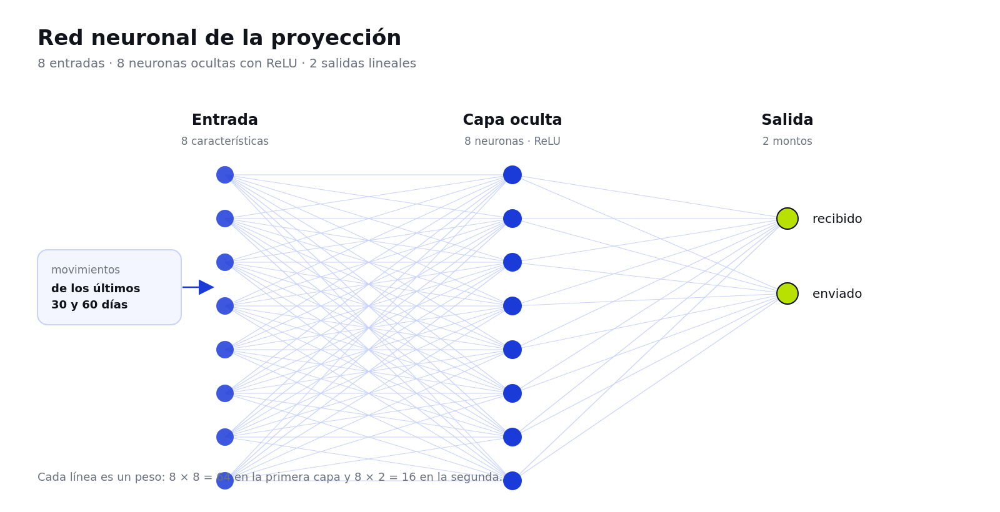
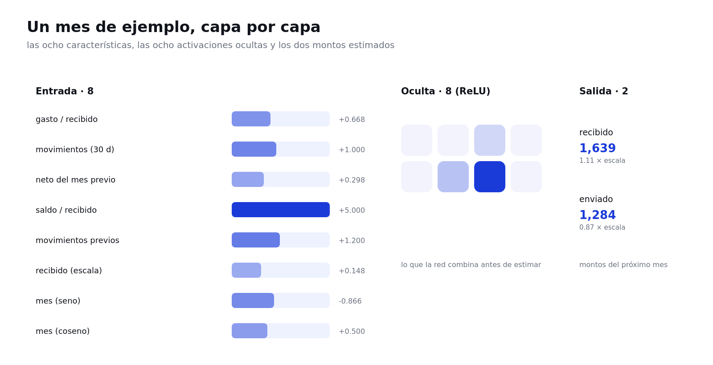

# Modelado de una red neuronal simple

> Apartado para insertar en el documento maestro, a continuación de «Integración de los
> modelos» y antes de «Estado del Arte». Los títulos respetan los cinco subtítulos que
> ya tiene el documento. Las figuras van en `docs/figuras/` y el código en
> `red_neuronal/`.

## Gráfico red neuronal



*Figura 1. La red de la proyección: 8 características de entrada, una capa oculta de 8
neuronas y 2 salidas, una por monto del próximo mes. Elaboración propia.*

## Propósito de la red neuronal dentro del sistema

La página de estadísticas cuenta lo que ya pasó: cuánto entró, cuánto salió y con quién.
Eso se calcula con aritmética exacta sobre el historial y **no lo toca ningún modelo**:
el saldo, las sumas y las gráficas siguen saliendo de la base de datos, porque son datos
que hay que poder comprobar.

La red agrega lo que la aritmética no puede dar: **una estimación de lo que va a pasar
el próximo mes** en esa cuenta. Recibe las ocho características de los últimos sesenta
días y devuelve dos montos, cuánto se espera recibir y cuánto enviar. La página los
muestra en una tarjeta aparte, marcada como «modelo de demostración», junto al resumen
exacto.

El ayudante que explica el sistema en palabras simples **no usa esta red**: ese asistente
trabaja con la API de un modelo de lenguaje, y esa es una decisión de diseño, no una
limitación. Un modelo de lenguaje redacta; esta red estima números. Mezclarlos sería
pedirle a cada uno lo que el otro hace mejor.

Dentro de la arquitectura, la red vive en un paquete propio (`red_neuronal/`) y la
aplicación la consulta desde `src/web/proyeccion.py`. No conoce PostgreSQL, no abre
conexiones y no puede modificar la cadena: sólo recibe los movimientos que la fachada ya
leyó y devuelve dos números.

## Datos de entrada y resultado esperado

**Entrada: ocho características de los últimos sesenta días.** Seis son relaciones con
lo que la cuenta recibió —no montos en pesos— y dos son el mes del año:

| Característica | Qué mide | Por qué |
| --- | --- | --- |
| `gasto_relativo` | lo enviado sobre lo recibido | Distingue una cuenta que gasta todo de una que ahorra |
| `movimientos_30d` | cuántas operaciones hubo | Una cuenta activa no se proyecta igual que una quieta |
| `neto_relativo` | el neto de los 30 días anteriores | La tendencia del mes previo |
| `colchon` | el saldo sobre lo recibido | Cuántos meses de gasto tiene disponibles |
| `movimientos_previos` | operaciones de los 30 días anteriores | Si la actividad sube o baja |
| `recibido_escala` | lo recibido, dividido por 10.000 | Conserva el tamaño de la cuenta |
| `mes_seno` y `mes_coseno` | el mes del año | Diciembre y enero quedan juntos, como en la serie |

Trabajar con proporciones es lo que permite que **un mismo modelo sirva para un fondo
que mueve 80.000 al mes y para una cuenta que mueve 1.000**: la red aprende la forma del
comportamiento, no el tamaño. La aplicación vuelve a pesos multiplicando por lo que esa
cuenta recibió.

**Salida: dos proporciones.** Lo que se espera recibir y lo que se espera enviar el mes
siguiente, medidas sobre lo recibido este mes. La aplicación las multiplica por la escala
de la cuenta y muestra los montos. Un tope las ajusta a la realidad: el envío estimado
nunca supera el saldo disponible más lo que se espera recibir, porque el ledger tampoco
lo permitiría (`REQ-05`).

**Qué no hace.** No decide si una transacción es válida, no firma, no agrupa bloques y
no calcula saldos. Es una estimación, y se presenta como tal.

## Representación gráfica de sus capas: entrada, capa oculta y salida



*Figura 2. Un mes de la serie atravesando la red: las ocho características con su valor,
las ocho activaciones ocultas y los dos montos estimados, calculados con el modelo
entrenado. Elaboración propia.*

1. **Capa de entrada (8 neuronas).** Una por característica. No tiene activación: entrega
   el dato tal cual, ya normalizado a un orden de magnitud comparable.
2. **Capa oculta (8 neuronas, ReLU).** Totalmente conectada con la entrada: 8 × 8 = 64
   pesos. La ReLU deja pasar lo positivo y apaga lo negativo, que es lo que permite
   combinar señales —«gasta casi todo» y «diciembre»— en lugar de mirarlas por separado.
3. **Capa de salida (2 neuronas, lineal).** Conectada con las ocho ocultas: 8 × 2 = 16
   pesos. Sin activación, porque son montos y no probabilidades. La red tiene **80 pesos**
   en total.

Durante el entrenamiento se apaga una de cada veinte neuronas ocultas (dropout), para que
una red tan chica no memorice la serie; al estimar, todas vuelven a estar activas.

## Explicación breve de su funcionamiento y de cómo apoyaría el proceso transaccional

El entrenamiento ajusta los 80 pesos con el optimizador Adam para bajar el error
cuadrático medio entre el monto estimado y el que de verdad ocurrió. El modelo se entrena
con **240 meses sintéticos** de un fondo de empleados —aportes estables, retiros con
picos en julio y diciembre, meses flojos y ruido— porque el prototipo no tiene histórico
propio. Es un dato de demostración, declarado como tal.

Para saber si el modelo sirve, no alcanza con el error: hay que compararlo con dos
predicciones ingenuas. Sobre los 48 meses que el modelo no vio al entrenar:

| Salida | Modelo | Repetir el mes anterior | Predecir el promedio |
| --- | --- | --- | --- |
| Recibido del próximo mes | **151 pesos** de error | 497 pesos | 323 pesos |
| Enviado del próximo mes | **130 pesos** de error | 618 pesos | 266 pesos |

El error medio es de **140 pesos**, un 8 % del monto típico, y en las dos salidas gana a
las dos alternativas. Ese contraste es la prueba de que aprendió una estacionalidad y no
sólo repite un promedio.

**Cómo apoya el proceso transaccional.** El proceso que el proyecto protege es el
registro de una operación: la wallet firma, la transacción se valida, entra al pool, se
agrupa en un bloque encadenado y se puede verificar después. La red no interviene en
ninguna de esas etapas y no puede alterarlas. Lo que agrega es lectura: convierte el
historial en una expectativa, para que quien usa el sistema pueda anticipar si el mes que
viene va a poder cubrir sus retiros. Es información para decidir, no una decisión.

## Nota de implementación

El modelo está implementado con **TensorFlow y Keras** y corre **dentro de la
aplicación**, en cada visita a la página de estadísticas:

| Archivo | Qué hace | ¿Necesita TensorFlow? |
| --- | --- | --- |
| `red_neuronal/caracteristicas.py` | Las ocho características y la escala | No |
| `red_neuronal/serie.py` | La serie sintética de entrenamiento | No |
| `red_neuronal/modelo.py` | La red 8 → 8 → 2 | Sí |
| `red_neuronal/entrenar.py` | Entrena, compara con las líneas base y guarda | Sí |
| `red_neuronal/figuras.py` | Genera las figuras 1 y 2 con los valores del modelo | Sí |
| `src/web/proyeccion.py` | Carga el modelo, resume el historial real y proyecta | Sí, por dentro |

La aplicación importa TensorFlow **sólo cuando hay que proyectar**, y una vez cargado el
modelo queda en memoria. El arranque adelanta esa carga en un hilo de fondo para que la
primera visita no espere. Si TensorFlow no está instalado o el modelo no está en su
ruta, la tarjeta de proyección simplemente no aparece y el resto de la página sigue
igual: la dependencia pesada no es obligatoria para usar el prototipo.

TensorFlow va en `red_neuronal/requirements.txt` y no en el `requirements.txt` del
proyecto. Reproducir las cifras de este apartado:

```text
python3.14 -m venv .venv-tf
.venv-tf/bin/python -m pip install -r red_neuronal/requirements.txt
.venv-tf/bin/python -m red_neuronal.entrenar
.venv-tf/bin/python -m red_neuronal.figuras
```

La salida cruda de esa corrida está guardada en
`docs/evidencias/red-neuronal-entrenamiento.txt`. Resultados (semilla 2026, 600 épocas
con parada temprana, 244 corridas):

| Medida | Valor |
| --- | --- |
| Meses de la serie / ejemplos | 240 / 238 |
| Entrenamiento / validación | 190 / 48 |
| Error absoluto medio en validación | 140 pesos (8 % del monto típico) |
| Error de las líneas base | 323 y 497 pesos (promedio y mes anterior) |
| Pesos de la red | 80 |

**Límites declarados.** La serie es sintética: la proyección demuestra el método, no
afirma nada sobre el dinero real de una organización. Con más historial real, el modelo se
reentrena con `entrenar.py` y las cifras del documento se actualizan solas desde
`resultados.json`.

## Referencias de este apartado

Goodfellow, I., Bengio, Y. y Courville, A. (2016). *Deep Learning*. MIT Press.
https://www.deeplearningbook.org/

Nielsen, M. (2015). *Neural Networks and Deep Learning*. Determination Press.
http://neuralnetworksanddeeplearning.com/

Rosenblatt, F. (1958). The perceptron: A probabilistic model for information storage and
organization in the brain. *Psychological Review, 65*(6), 386–408.
https://doi.org/10.1037/h0042519

TensorFlow. (s. f.). *Keras: the high-level API for TensorFlow*. Recuperado el 4 de
noviembre de 2026, de https://www.tensorflow.org/guide/keras

TensorFlow. (s. f.). *Overfit and underfit*. Recuperado el 4 de noviembre de 2026, de
https://www.tensorflow.org/tutorials/keras/overfit_and_underfit
